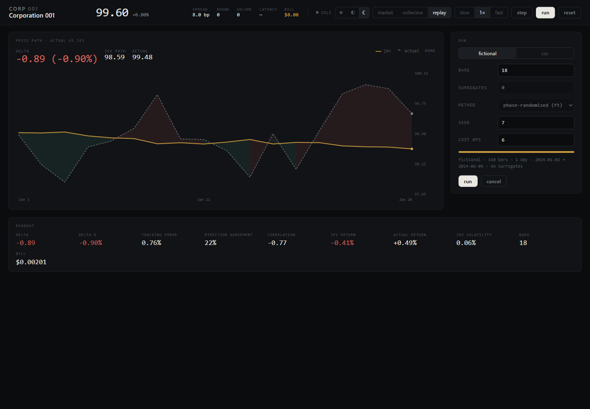
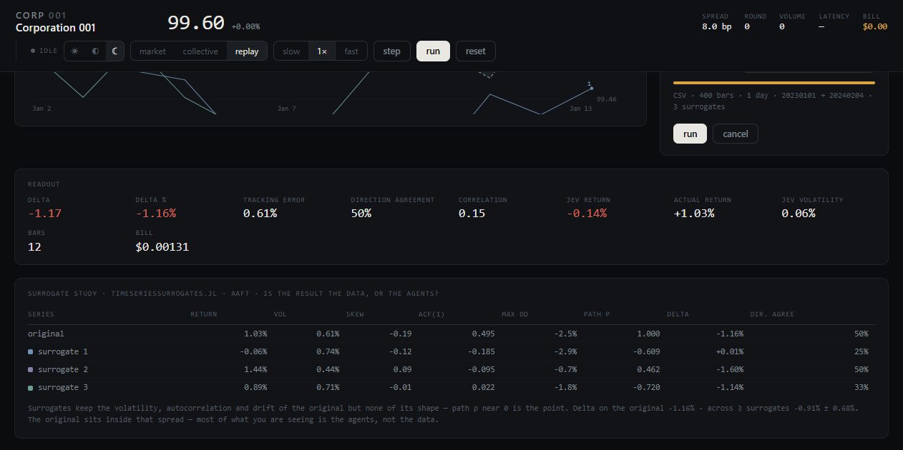

# CORPORATION 001 — Manual

A microstructure market simulator in which every market participant is a **Jev** (a TypeSafe
System One model). Five agents answer one atomic probability question each round. Code — never the
model — converts those probabilities into orders, fills, price impact and quotes.

Everything below describes exactly what the code does. Where a number is a judgement call rather
than a principle, it is marked as such.

---

## Contents

1. [Quick start](#1-quick-start)
2. [What this is, and what it is not](#2-what-this-is-and-what-it-is-not)
3. [The instrument](#3-the-instrument)
4. [The five Jevs](#4-the-five-jevs)
5. [The round, step by step](#5-the-round-step-by-step)
6. [Price formation, in full](#6-price-formation-in-full)
7. [The market maker](#7-the-market-maker)
8. [Reading the market view](#8-reading-the-market-view)
9. [Reading the collective view](#9-reading-the-collective-view)
10. [Snapshots](#10-snapshots)
11. [Controls and keyboard](#11-controls-and-keyboard)
12. [HTTP API](#12-http-api)
13. [Architecture and file map](#13-architecture-and-file-map)
14. [Tuning constants](#14-tuning-constants)
15. [Cost and latency](#15-cost-and-latency)
16. [Hosting and access control](#16-hosting-and-access-control)
17. [Failure modes](#17-failure-modes)
18. [Known limitations](#18-known-limitations)
19. [Extending it](#19-extending-it)
20. [Troubleshooting](#20-troubleshooting)
21. [Billing](#21-billing)
22. [Themes](#22-themes)
23. [Glossary](#23-glossary)
24. [Replay engine](#24-replay-engine)
25. [Surrogates](#25-surrogates)
26. [Mechanics reference](#26-mechanics-reference)

---

## 1. Quick start

```bash
git clone <this repo> && cd corporation-001
cp .env.example .env          # then put your TypeSafe key in it
npm start                     # → http://127.0.0.1:4362
```

There is nothing to install: the whole app is Node's standard library plus `fetch`. Node 20+.

Press **run**. Each round takes roughly 300–900 ms: five Jev calls in parallel, then the market
reprices. Press **pause** to stop cleanly at the end of the current round.

### The key

`jev.mjs` resolves the key once per process, in this order:

1. `TYPESAFE_API_KEY`
2. `TYPESAFE_KEY_FILE` — a path to a file containing the key (Docker secrets, vault mounts)
3. `TYPESAFE_API_KEY=` in a `.env` file in the working directory

The key never reaches the browser. Only the server holds it, and the browser only ever talks to the
app's own origin.

### Environment

| Variable | Default | Meaning |
|---|---|---|
| `TYPESAFE_API_KEY` | — | **Required** (unless `TYPESAFE_KEY_FILE` is set) |
| `TYPESAFE_KEY_FILE` | — | Path to a file holding the key |
| `JEV_MODEL` | `jev-1.14.0` | Any System One model identifier |
| `JEV_PRICE_PER_MTOK` | `0.042` | Dollars per million input tokens, used for the on-screen bill (§21) |
| `TYPESAFE_ENDPOINT` | `https://api.typesafe.ai/v1/systemone` | API base |
| `PORT` | `4362` | HTTP port |
| `HOST` | `127.0.0.1` | Bind address. `0.0.0.0` for containers and public hosts |
| `ACCESS_TOKEN` | — | Shared secret gating `/api/*`. Set before exposing the host |

---

## 2. What this is, and what it is not

**It is:** a small, legible market where the judgement layer is a calibrated model rather than a
hand-written rule. You can watch five independent probability distributions turn into order flow,
watch the book rebuild around the flow, and watch the same five models change their minds as the
tape changes.

**It is not:** a backtester, a price predictor, or a claim about how real markets behave. There is no
queue position, no latency jitter, no borrow cost, no funding, no partial-fill realism beyond a
linear slippage term, and no second venue. The agents are general-purpose judgement models being
asked to play a role, not traders trained on order flow.

The honest framing: **this is a machine for making probability distributions visible and
consequential.** The microstructure is a plausible stage, not a simulation study.

---

## 3. The instrument

| | |
|---|---|
| Name | **CORPORATION 001** (ticker `CORP 001`) |
| Opening mid | **99.60** |
| Opening fair value | **100.00** |
| Tick size | **0.05** |
| Book depth | 5 levels per side |
| Best-level size | ~900 shares, growing ~55% per level |
| Opening spread | 8.0 bp (0.08 on a 100 price) |

The opening price is deliberately **below** fair value by 40 bp, and a headline is seeded at round 0.

This matters more than it looks. A market that opens exactly at fair value, with no tape and no
headline, is a market where every Jev correctly answers *hold* — with 0.98–1.00 confidence. The first
version of this app did exactly that and sat perfectly dead: no trades, no information, no reason to
trade, forever. The seeded gap and the seeded headline are the bootstrapping crank.

---

## 4. The five Jevs

Every round, each agent receives a JSON `state` object and answers **one** `choice` question. One
judgment per question, one call per agent. Nothing is batched into a compound "what should you do
and how big" question, because a compound question produces an uninterpretable distribution.

All five share this base state:

```json
{
  "asset": "CORPORATION 001",
  "round": 14,
  "mid": 100.42,
  "bid": 100.36,
  "ask": 100.48,
  "spread_bps": 12.1,
  "your_position_shares": 620,
  "your_pnl": 118.40
}
```

### 4.1 Aurelia — market maker

*Quotes both sides, carries the inventory, is the counterparty to every fill.*

**Extra state**

```json
{
  "inventory_vs_target_shares": -3380,
  "price_change_last_5_rounds_pct": 0.84,
  "recent_flow": [{"side":"buy","shares":140,"price":100.31}, ...]
}
```

**Question**

> You are the only market maker in CORPORATION 001. You quote a bid and an ask every round and you
> are the counterparty to every trade. How should you quote in the next round?

| Criterion | Text |
|---|---|
| `tighten` | Narrow the spread. Volume is healthy and inventory is close to target, so capture more flow. |
| `hold` | Keep the current spread. Nothing in the flow or your inventory justifies a change. |
| `widen` | Widen the spread. Inventory is far from target or the tape is unstable, so charge more for the risk. |

Aurelia does **not** choose a price. She chooses a posture; §7 turns posture into a number.

### 4.2 Kestrel — momentum

**Extra state:** `change_1_round_pct`, `change_3_rounds_pct`, `change_5_rounds_pct`, `recent_flow`.

> You trade CORPORATION 001 as a momentum trader: you buy strength and sell weakness, and you avoid
> trading when the tape is flat or contradictory. What is your order this round?

| Criterion | Text |
|---|---|
| `buy` | The recent move is up and it is still carrying. Add to the position now. |
| `sell` | The recent move is down and the selling is still carrying. Reduce or go short now. |
| `hold` | The move is flat, exhausted, or contradicts itself. Sit out this round. |

Max order: **140 shares**.

### 4.3 Hollis — value

**Extra state:** `your_fair_value_estimate`, `price_versus_your_estimate_pct`.

> You trade CORPORATION 001 on value. You have your own estimate of what it is worth and you trade
> against the gap between the price and that estimate, ignoring the tape. What is your order this
> round?

| Criterion | Text |
|---|---|
| `buy` | The price sits clearly below your estimate. Buy the discount. |
| `sell` | The price sits clearly above your estimate. Sell the premium. |
| `hold` | The price is close enough to your estimate that there is no edge worth trading. |

Max order: **120 shares**. Hollis is the anchor: he is the reason the market mean-reverts rather
than drifting off on momentum alone.

### 4.4 Vega — news

**Extra state:** `latest_headline`, `rounds_since_headline`, `change_since_headline_pct`.

> You trade CORPORATION 001 on news. You read the latest headline and decide whether the market has
> already priced it. What is your order this round?

| Criterion | Text |
|---|---|
| `buy` | The headline is good news the price has not fully absorbed yet. Buy now. |
| `sell` | The headline is bad news the price has not fully absorbed yet. Sell now. |
| `hold` | There is no fresh headline, or the price has already absorbed it. Do nothing. |

Max order: **110 shares**.

### 4.5 Nyx — scalper

**Extra state:** `your_fills_so_far`, `recent_flow`.

> You scalp CORPORATION 001: you take liquidity when the spread is wide enough to pay you and you
> stay flat when it is not. What is your order this round?

| Criterion | Text |
|---|---|
| `buy` | The spread is wide and the last trades are being lifted. Buy and work the position out. |
| `sell` | The spread is wide and the last trades are hitting the bid. Sell into it. |
| `hold` | The spread is too tight to pay for the risk. Stay flat this round. |

Max order: **70 shares**. Nyx is the agent most sensitive to Aurelia's posture: when the maker
widens, the taker appears.

### Why criteria are written this way

Jev reads the criteria as *definitions of what each label means*, not as a menu of vibes. Each one is
phrased as a falsifiable condition ("the price sits clearly below your estimate") so the probability
reflects the state rather than narrative plausibility. This is the single largest quality lever in
the whole app: vague criteria produce 0.33/0.33/0.34 in every state, which looks like a working
distribution and is actually a shrug.

### Why the answers are decisive

The observed behaviour on a flat book: `{"buy":0,"sell":0,"hold":1}` with confidence `1.00`. On a
40 bp discount: `{"buy":0.80,"sell":0.02,"hold":0.18}`. That is the model being *correct*, not the
model being brittle. If all five hold every round, your market has no information in it — check §3.

---

## 5. The round, step by step

`runRound(m)` in `market.mjs`. Order is exact.

### Step 1 — increment

```
m.round++
```

### Step 2 — maybe news

A headline fires if `m.quiet >= 2` **or** `random() < 0.16`.

`m.quiet` counts consecutive rounds with zero traded volume. Without the forced branch, a converged
market has no catalyst, all five Jevs correctly hold, and the sim freezes. The forced branch is a
deliberate cheat: it guarantees the world keeps offering something to judge.

On a headline:

```
shock = (random() - 0.5) * 0.012        // ±0.6%
m.fair = round2(m.fair * (1 + shock))
```

The text is drawn from two fixed pools of three phrases each, positive and negative. **The headline
text does not affect any number** — `shock` does. Vega reads the text to decide whether the move has
been absorbed; the text and the shock are independent, which is a modelling shortcut worth knowing
about.

The last 12 headlines are retained.

### Step 3 — ask all five, in parallel

```js
await Promise.all(m.agents.map(a => systemOne({ state, questions: { d: question } })))
```

Five concurrent HTTP requests. Round latency ≈ the slowest single call, not the sum. Each agent's
`last` record stores `action`, the full probability vector, and `confidence`.

A failed call is caught per-agent: that agent's `probs` become `null`, and it is treated as a hold.

### Step 4 — probability becomes an order

For a **trader**:

```
pBuy   = probs.buy
pSell  = probs.sell
intent = pBuy - pSell

if intent >  +0.12  -> buy
if intent <  -0.12  -> sell
else                -> hold

size = clamp( round(min(1, |intent| * 1.25) * maxSize / 10) * 10, 10, maxSize )
```

Read that size formula carefully, because it is where judgement becomes quantity:

- `|intent| * 1.25` maps a probability margin into a 0–1 fraction, saturating at a margin of 0.8.
- Multiply by the agent's `maxSize` (140 / 120 / 110 / 70).
- Round to the nearest 10 shares, floor at 10.

So `p(buy)=0.62, p(sell)=0.30` → intent `0.32` → fraction `0.40` → Kestrel buys **56 → 60** shares.
A unanimous `p(buy)=0.95, p(sell)=0.01` → intent `0.94` → fraction `1.0` → the full **140**.

`HOLD_BAND = 0.12` is the dead zone. Without it, a 0.02 margin would trade one share forever and
the book would drown in noise.

For the **market maker**, see §7.

### Step 5 — fill, at a price that includes slippage

```
slip     = 1 + IMPACT * size * 0.55
buyPx    = round2(ask * slip)
sellPx   = round2(bid / slip)
```

A 140-share buy lifts the ask by about 0.04% more than the quote. This is the only form of
"liquidity is finite" in the model that the trading agent directly feels.

### Step 6 — move money

Every fill has Aurelia on the other side:

| | trader | Aurelia |
|---|---|---|
| buy | position `+size`, cash `−size·px` | position `−size`, cash `+size·px` |
| sell | position `−size`, cash `+size·px` | position `+size`, cash `−size·px` |

`netFlow += ±size`, `volume += size`, `fills += 1`, and a tape entry is appended with the wall-clock
time, the agent's name, side, size and execution price.

### Step 7 — reprice

```
m.mid = round2(m.mid * (1 + netFlow * IMPACT))
m.mid = round2(m.mid + (m.fair - m.mid) * REVERT)
```

### Step 8 — rebuild the book

`rebuild(m, mult, skew)` using Aurelia's posture (§7). Both sides get fresh randomised depth, so the
ladder is not identical round to round.

### Step 9 — mark to market

```
pnl = cash + position * mid
```

Everyone is marked at the same mid, including Aurelia. Positions are unbounded — nobody is forced to
cover.

### Step 10 — housekeeping, then broadcast

`quiet` increments if volume was zero, else resets to 0. History (max 400 points) and the tape (max
200 lines) are trimmed. The server broadcasts the full snapshot to every connected browser.

---

## 6. Price formation, in full

Three forces, applied in this order every round.

**1. Order-flow impact** — linear in net shares, symmetric in sign.

```
mid_new = mid * (1 + netFlow * 0.0000055)
```

| Net flow | Move |
|---|---|
| ±50 shares | ±0.03% |
| ±200 shares | ±0.11% |
| ±500 shares | ±0.28% |

With five agents capped at 140/120/110/70 (470 shares if all lean the same way), the maximum
one-round dislocation from flow alone is about ±0.26%. This is a *Kyle-lambda-style* linear impact:
simple, monotone, and deliberately not square-root.

**2. Mean reversion toward fair value**

```
mid += (fair - mid) * 0.07
```

7% of the gap closes each round, so a 40 bp dislocation half-closes in roughly nine rounds. This is
what stops momentum from running the price to infinity and gives Hollis a business model.

**3. Fair value itself**

Fair value only moves on news: ±0.6% uniform, applied multiplicatively. Between headlines it is
constant. The chart plots it as a thin dashed line, and it is the one line in the app that is not
derived from what the Jevs think.

**What is not modelled:** no inventory cost curve for the maker beyond its skew, no adverse-selection
term, no shorting constraints, no borrow, no funding, no circuit breakers, no crossing between
participants (every fill goes through Aurelia).

---

## 7. The market maker

Aurelia's distribution over `{tighten, hold, widen}` becomes a **width multiplier** — a weighted
average over three fixed postures, not a free choice of number:

```
mult = p(tighten)*0.68 + p(hold)*1.00 + p(widen)*1.75
mult = clamp(mult, 0.6, 2.2)
```

The quoted half-spread is then:

```
half = (mid * 8bp / 10000) * mult * 0.5
bid  = round2(mid - half + skew)
ask  = round2(mid + half + skew)
```

Note the base width is the **constant** `8 bp`, not the previous round's width. An earlier version
re-derived the next width from the current bid/ask and the multiplier compounded: eight rounds of
"widen" took the spread from 8 bp to **114 bp**, quietly killing the market. Any change here must keep
quoting off a fixed base.

The skew is inventory-driven:

```
drift = (position - 4000) / 4000
skew  = -drift * 0.035
```

- Long 4,000 (target) → skew 0.
- Long 6,000 → `drift = +0.5`, skew `−0.0175`: quotes shift **down**, discouraging further buying and
  encouraging sellers to hit the bid.
- Short 2,000 → quotes shift **up**, attracting the sellers Aurelia needs to buy back from.

`0.035` is a tuning choice: at maximum realistic inventory (±4,000 shares) it is worth about ±1.75
cents against an 8–14 bp spread, i.e. large enough to matter, small enough not to invert the market.

Because the maker is the counterparty to all five traders, its inventory is exactly the negative of
everyone else's: `mm.position = 4000 − Σ trader positions`. That identity is also a useful sanity check.

---

## 8. Reading the market view

The default view. Five regions.

### 8.1 Header

| Field | Meaning |
|---|---|
| **CORP 001 / Corporation 001** | The instrument |
| **Price** | Current mid, 2 dp |
| **+0.89%** | Change from the oldest point in the retained history (green up, red down) |
| **SPREAD** | Current quoted spread in basis points, derived from `(ask−bid)/mid` |
| **ROUND** | Rounds completed since reset |
| **VOLUME** | Cumulative shares traded since reset (not since load — reset clears it) |
| **LATENCY** | Wall-clock duration of the last full round, including all five Jev calls |
| **BILL** | Session cost so far, in dollars, at the configured rate. Flashes amber on every new round |

### 8.2 Chart

- **White line** — mid price, one point per round.
- **Amber band** — the bid/ask envelope. Its thickness is the spread. On a tightly-ranged chart this
  band looks thick because the vertical scale is zoomed in; that is honest, not a rendering bug.
- **Dashed blue line** — fair value. It is a step function: flat between headlines, jumping when one
  lands.
- **Right-hand axis** — price. Range is auto-fitted to `min/max` of both mid and fair, padded 15%.
- **Grey wash** — area under the mid line. Pure decoration.

The chart holds the last **180 rounds**.

### 8.3 Tape

Newest first. Columns: wall-clock time, agent name, side and size, execution price. Green = buy,
red = sell. Holds **14 entries** in the stream payload, 200 on the server.

The tape is the only place where the *executed* price is visible; the chart shows mid, which lags the
fill by construction.

### 8.4 Headlines

Newest first, tagged with the round that produced them (`R15`). Only the last 4 travel to the browser.

### 8.5 Order book

Asks climbing down to the mid row, then bids. Bar length is depth proportional to the largest
resting level on either side.

The **level selector** in this panel sets how many rows the book shows: 10 by default (5 per side),
20, 50 or 100. A deep book scrolls inside the panel — the pane is pinned to the height the market
column sets, so a 100-row ladder never stretches the page. Changing depth rebuilds the book
immediately at the current mid, spread and skew.

- Red-tinted prices = asks (you pay these).
- Green-tinted prices = bids (you hit these).
- The mid row shows the mid and the spread in bp.

### 8.6 Agent strip

One card per Jev, always visible, always live:

| Element | Meaning |
|---|---|
| Name, role | Who, and what discipline |
| Badge | `BUY` / `SELL` / `HOLD`, or `TIGHTEN` / `HOLD` / `WIDEN` for Aurelia |
| Probability bar | Green segment = `p(buy)`, red = `p(sell)`. For Aurelia: green = `p(tighten)`, red = `p(widen)` |
| Position | Shares held (negative = short) |
| PnL | Marked to the current mid, green above zero, red below |
| Right line | Order size (traders) or width multiplier (Aurelia) |
| `c 0.85` | The model's own confidence in its answer |
| `756 tok · $0.0000318` | What *this call* cost — tokens used and dollars billed. Flashes each round. See §21 |

A dimmed card means that agent's Jev call failed this round.

---

## 9. Reading the collective view

Click **collective** in the header. The market panes are replaced by two cards; the agent strip stays
visible at the bottom, so you never lose sight of the individuals while looking at the aggregate.

### 9.1 Decision split

A single stacked bar: how many traders chose buy / sell / flat **this round** — `1 buying · 3 selling ·
0 flat`. Counts, not sizes. A round where one agent trades 140 and three trade 20 shows as 1/3, which
is the point: activity, not volume.

### 9.2 Signed intent, per Jev

The most important panel in the app. For each agent:

```
trader:  intent = p(buy) - p(sell)
maker:   intent = p(tighten)*0.35 - p(widen)*0.35
```

Rendered as a diverging bar from a centre tick: green to the right, red to the left, at half-scale
(`|intent| = 1` fills the half-track). The number is printed to 2 dp.

This is the **conviction** layer, and it is more informative than the badges. Two agents can both
show `BUY` while one has intent `+0.95` (nearly certain) and the other `+0.14` (barely through the
dead zone). The badges hide that; this panel does not.

### 9.3 Aggregate readout

| Field | Definition |
|---|---|
| **net flow (shares)** | Signed sum of fills *this round only*: buys − sells |
| **consensus** | Mean signed intent across all five agents (trader intent and maker intent averaged together). Range roughly −1..+1. `−0.31` means the room leans bearish |
| **market maker inventory** | Aurelia's shares, against a 4,000 target |
| **quoted width** | Aurelia's multiplier, `1.00×` = base 8 bp |

Consensus is a *description*, not a forecast. It tells you what the five models jointly think right
now, given the same public state. It is not advice and it has no predictive claim.

### 9.4 Ledger

Every agent's current PnL, marked to mid, in the same colour language as the strip.

Nothing here is "realised" — there is no closing of positions and no distinction between paper and
locked-in profit. A trader who bought at 99.6 and holds at 100.4 shows +PnL and still has the risk.

### 9.5 TypeSafe bill

A full-width card under the two panels. Three headline numbers — **this round**, **session**, and
**rate** — then one row per agent:

| Column | Meaning |
|---|---|
| agent | Who |
| calls | Successful calls this session (a failed call is not billed and not counted) |
| tokens | Input + output tokens consumed |
| per call | Mean cost of one call |
| total | Cost attributed to that agent |
| share | That agent's slice of the whole bill, as a bar and a percentage |

The per-agent rows are the interesting part: five agents against the same market do not cost the
same, because their state payloads differ in length. Aurelia carries extra inventory fields; Hollis
carries a fair-value estimate. Over a long session the difference is small but it is real, and it is
the only place in the app where you can see it.

### 9.6 Snapshot controls

See §10.

---

## 10. Snapshots

Press **take snapshot**. The current round's collective state is frozen into a JSON document and
shown in a monospace panel. **copy json** puts it on the clipboard.

The market keeps running underneath. A snapshot is a *point sample*, not a pause. This is
deliberate — you are meant to be able to grab a moment while the thing is live.

### Snapshot schema

```json
{
  "at": "2026-11-07T12:38:13.269Z",
  "round": 22,
  "mid": 99.62,
  "fair": 99.82,
  "spread_bp": 14.1,
  "decisions": [
    {
      "agent": "Aurelia",
      "role": "market maker",
      "action": "widen",
      "confidence": 0.91,
      "probs": { "tighten": 0.01, "hold": 0.08, "widen": 0.91 },
      "intent": -0.32,
      "position": 3110,
      "pnl": -426.30
    }
  ],
  "aggregate": {
    "buys": 1,
    "sells": 3,
    "flat": 0,
    "market_maker_inventory": 3110,
    "quote_width": 1.70
  },
  "bill": {
    "round": { "calls": 5, "tokens": 3678, "cost": 0.0001463 },
    "total": { "rounds": 16, "calls": 80, "tokens": 57035, "cost": 0.0022651 },
    "price_per_mtok": 0.042
  }
}
```

| Field | Notes |
|---|---|
| `at` | ISO-8601 UTC timestamp of the capture |
| `round` | Rounds since reset |
| `mid`, `fair` | Prices at capture |
| `spread_bp` | Quoted spread in basis points |
| `decisions[]` | One entry per agent, in fixed order (maker first) |
| `decisions[].probs` | The **raw** model distribution, unmodified. This is the record of what the model actually said |
| `decisions[].intent` | The derived conviction, 3 dp |
| `decisions[].position`, `.pnl` | Marked to the capture mid |
| `aggregate` | Counts and maker state |

Raw probabilities are preserved deliberately: the whole point of the app is to make the calibration
auditable. If you only keep `action`, you lose the thing that produced it.

Snapshots are **client-side only** — nothing is written to disk. Refresh the page and the last
snapshot is gone.

---

## 11. Controls and keyboard

| Control | Action |
|---|---|
| **run / pause** | Starts the loop, or stops it after the current round completes |
| **step** | Pauses if running, then runs exactly one round |
| **reset** | Pauses, discards the market, rebuilds from the opening state (round 0, mid 99.60) |
| **slow · 1× · fast** | Sets the inter-round delay: 1400 ms, 350 ms, 0 ms |
| **☀ ◐ ☾** | Light / medium / dark theme (§22) |
| **10 / 20 / 50 / 100 levels** | Order-book depth (§8.5, §26.3) |
| **market · collective** | Switches view. Does not affect the market |

| Key | Action |
|---|---|
| `Space` | run / pause |
| `S` | step |
| `R` | reset |

**Speed is a delay, not a throttle.** At `fast`, rounds run back-to-back and the real constraint
becomes Jev latency (~300–900 ms). You cannot make it faster than the model.

The live indicator reads `IDLE`, `LIVE`, or **`JEVS THINKING`** while a round is in flight.

---

## 12. HTTP API

Everything is `127.0.0.1:4362` by default.

If `ACCESS_TOKEN` is set, every `/api/*` route requires it — as `Authorization: Bearer <token>`,
`X-Access-Token: <token>`, or `?token=<token>`. See §16. The examples below assume it is unset.

### `GET /api/state`

One-shot snapshot of the full market. Same object the stream pushes.

### `GET /api/stream`

Server-Sent Events. On connect you immediately receive one `round` event with the current state, then
one per round. A comment heartbeat (`: beat`) is sent every 20 s to keep intermediaries from closing
an idle connection.

Four event types:

| Event | Payload | Meaning |
|---|---|---|
| `round` | full snapshot | a round completed |
| `thinking` | `{ round }` | a round started; use for a spinner |
| `control` | `{ running, speed }` | start/pause/speed changed elsewhere |
| `error` | `{ message }` | the round threw |

### `POST /api/control`

Body: `{ "cmd": "...", ... }`

| cmd | Body | Effect |
|---|---|---|
| `start` | — | Begin the loop (no-op if already running) |
| `pause` | — | Stop after the current round |
| `step` | — | Pause, then run one round |
| `reset` | — | Pause, rebuild a fresh market, broadcast |
| `speed` | `{"value":"slow"\|"normal"\|"turbo"}` | Set the inter-round delay |
| `depth` | `{"value":10\|20\|50\|100}` | Rebuild the book with that many rows |

`step` **awaits** the round, so a sequence of awaited `step` calls runs the market deterministically
one round at a time — that is how the app was verified:

```bash
for i in $(seq 1 10); do
  curl -s -X POST http://127.0.0.1:4362/api/control \
    -H 'content-type: application/json' -d '{"cmd":"step"}' -o /dev/null
done
curl -s http://127.0.0.1:4362/api/state | jq '.round, .mid'
```

### Replay endpoints

| Route | |
|---|---|
| `POST /api/replay/run` | starts a job; returns `{ id }`. Body: `{ source, csv?, bars, surrogates, method, seed, costBps }` |
| `GET /api/replay/stream?id=` | SSE for that job: `meta`, `bar`, `progress`, `original`, `surrogate`, `surrogateStart`, `done`, `error`, `close` |
| `GET /api/replay/result?id=` | poll-style summary: `{ done, meta, barCount, outcome }` |
| `GET /api/replay/last` | the most recent completed run |
| `POST /api/replay/cancel` | `{ id }` — stops after the bar in flight |

A run is a **job**, not a request. Events are buffered, so a client that connects late still
receives everything from `meta` onward. `surrogates` is honoured only for `source: "csv"`.

### Snapshot payload

```json
{
  "asset": "CORPORATION 001",
  "round": 22,
  "mid": 99.62, "fair": 99.82,
  "bid": 99.55, "ask": 99.69,
  "spreadBps": 14.1,
  "book": { "bids": [{"price":99.55,"size":812}, ...],
            "asks": [{"price":99.69,"size":812}, ...] },
  "tape":  [{"round":22,"time":"12:37:16","agent":"Nyx","side":"sell","size":20,"price":99.63}, ...],
  "news":  [{"round":15,"mid":99.81,"text":"..."}, ...],
  "history": [{"round":0,"mid":99.6,"bid":99.56,"ask":99.64,"fair":100}, ...],
  "stats": {"buys":31,"sells":29,"holds":44,"volume":5770,"calls":115,"fails":0},
  "lastRoundMs": 400,
  "agents": [{"id":"mm","name":"Aurelia","role":"market maker","kind":"quote",
              "position":3110,"cash":-306000,"pnl":-426.3,"fills":0,
              "last":{"action":"widen","probs":{...},"confidence":0.91,
                      "width_mult":1.70,"edge":70.0,"size":0,"error":null}}, ...],
  "running": false, "busy": false, "speed": "normal"
}
```

`stats.calls` counts every Jev request attempted; `stats.fails` counts exceptions. The ratio is your
health check.

---

## 13. Architecture and file map

```
corporation-001/
├── server.mjs          HTTP + SSE + the loop. No dependencies.
├── market.mjs          The engine: book, agents, one round. The interesting file.
├── jev.mjs             TypeSafe client: key resolution, one fetch, timeouts.
├── index.html          The whole UI: markup, CSS, canvas chart, SSE client.
├── replay.mjs          the event-driven replay engine (no look-ahead)
├── ohlcv.mjs           CSV parsing, descriptors, fallback surrogates
├── surrogates.jl       surrogate generation (TimeseriesSurrogates.jl)
├── julia-surrogates.mjs  spawns Julia, one call per run
├── julia/Project.toml  the Julia environment that pins the package
├── personas.mjs        the five-agent roster, shared by both engines
├── replay.js           the replay view's browser code
├── corp001.mjs         the Telegram surface (a thin client of this server)
├── sample.csv          180 bars of fictional daily OHLCV, for trying it
├── md2html.mjs         MANUAL.md → MANUAL.html for printing
├── package.json        `npm start`, engines, metadata. No dependencies.
├── .env.example        copy to .env and fill in the key
├── Dockerfile          node:22-alpine, binds 0.0.0.0
├── market.png          market view screenshot
├── collective.png      collective view screenshot
├── README.md           the front door
├── MANUAL.md           this document
└── LICENSE             MIT
```

**Data flow**

```
browser ──POST /api/control──▶ server ──▶ market.runRound()
                                            │
                                            ├─▶ jev.systemOne() ×5  (parallel)
                                            ├─▶ fills, impact, book rebuild
                                            └─▶ snapshot()
                                            │
browser ◀──SSE event: round─────────────────┘
```

No framework, no build step, no bundler, no `node_modules`. The entire dependency surface is Node's
standard library plus `fetch`.

The client never computes prices. It renders whatever the server last broadcast, and its only local
state is `mode`, `thinking`, and the last snapshot.

---

## 14. Tuning constants

All in `market.mjs` unless noted. Change one at a time; several interact.

| Constant | Value | What it does | Safe range / failure if pushed |
|---|---|---|---|
| `TICK` | `0.05` | Price grid step between book levels | Below ~0.02 the 2 dp display hides levels |
| `DEPTH0` | `900` | Shares at the best quote | Larger = slippage-resistant; below ~200 the book looks fake |
| `SPREAD_BASE` | `8` bp | Spread at a `1.0×` maker posture | **Fixed base.** Never derive this from the live spread |
| `IMPACT` | `0.0000055` | Price move per net share | Doubling it makes the market violently reflexive |
| `REVERT` | `0.07` | Fraction of the fair-value gap closed per round | Above ~0.3 the tape looks like a bounce simulator |
| `HOLD_BAND` | `0.12` | Dead zone on \|p(buy) − p(sell)\| | Below ~0.05 the market drowns in 10-share noise |
| news prob | `0.16` | Chance of a headline per round | Above ~0.4 fair value becomes noise |
| quiet trigger | `2` | Consecutive zero-volume rounds before a forced headline | `0` makes every round a headline |
| shock size | `±0.6%` | Fair-value move per headline | Large shocks + low `REVERT` = runaway drift |
| `size` factor | `×1.25` | Maps intent to order fraction | At `1.0` agents rarely reach `maxSize` |
| `maxSize` | 140/120/110/70 | Per-agent ceiling | Total ≤470 shares caps one-round flow impact |
| maker postures | `0.68 / 1.00 / 1.75` | Blended width per criterion | Pushing 1.75 to 2.5 makes the spread explode |
| maker clamp | `0.6 – 2.2` | Hard bounds on the multiplier | Removing this re-introduces the runaway spread |
| skew gain | `0.035` | Inventory-to-quote tilt | Above ~0.1 the maker quotes through fair value |
| slip factor | `0.55` | Extra cost per share traded | Makes large orders self-limiting |
| `LEVELS_DEFAULT` | `10` | Book rows shown at startup | Must be even; 100 is the ceiling |
| `LEVELS_MAX` | `100` | Hard cap on rows | Beyond ~200 the ladder stops being readable |
| opening mid | `99.60` | Below fair value by design | Setting it to 100 kills the market (see §3) |

---

## 15. Cost and latency

Measured against `jev-1.14.0`, text-only calls, one ordinary host:

| | |
|---|---|
| Latency per round | **300–900 ms** (parallel; equals the slowest of five) |
| Tokens per round | ~1,900–2,200 total across five calls |
| Tokens per call | ~380–400 |
| Cost | Fractions of a cent per round; a 500-round session is well under a dollar |

Five calls at ~400 tokens each is cheap because the state is compact and the criteria are short.
If you extend the state with long documents, cost and latency scale with the *slowest* agent, so a
single bloated state builder degrades the whole market.

Rate limits: each request counts against normal System One limits. Five concurrent requests per round
is well inside typical allowances, but `fast` mode with no delay will run them back-to-back
indefinitely — watch `stats.fails`.

---

## 16. Hosting and access control

The app binds **127.0.0.1** by default. That is the correct default: on localhost the API can safely
be open, because only you can reach it.

### Docker

```bash
docker build -t corporation-001 .
docker run -p 4362:4362 \
  -e TYPESAFE_API_KEY=sk_... \
  -e ACCESS_TOKEN=$(openssl rand -hex 16) \
  corporation-001
```

Then open `http://<host>:4362/?token=<ACCESS_TOKEN>`. The page stores the token for the session and
sends it on every API call and on the event stream.

### The access token

Without `ACCESS_TOKEN`, `/api/*` is open. That is a real hazard on a public host: `POST
/api/control {"cmd":"start"}` runs rounds forever and spends your TypeSafe credits. Anyone who finds
the port can do it.

With `ACCESS_TOKEN` set, the server requires the secret on every `/api/*` request, accepted as:

| Where | Form |
|---|---|
| Header | `Authorization: Bearer <token>` |
| Header | `X-Access-Token: <token>` |
| Query | `?token=<token>` — needed by `EventSource`, which cannot set headers |

Comparison is constant-time (`timingSafeEqual`). The static files are not gated; they contain no
secrets and no data.

### Notes for a public deploy

- Put it behind TLS (Caddy, nginx, a PaaS router). The token is a bearer secret in a URL.
- The market is **single-process, in-memory**. Two replicas are two different markets; there is no
  shared state and no persistence. Scale to one.
- A round costs five API calls. There is no rate limit, no budget cap and no per-IP throttle —
  `ACCESS_TOKEN` is the only gate. If you need more, put a limiter in front.

---

## 17. Failure modes

**A Jev call fails** (network, 429, 500, malformed response). That agent's `last.error` is set and it
is treated as a **hold** for the round. The card dims. The market continues with four opinions. The
failed call still counts in `stats.calls` and `stats.fails`.

**The key is missing or wrong.** Every call fails, every agent holds forever, `fails` increments five
per round, and the market never trades — but the app does not crash. Check `TYPESAFE_API_KEY` or the
`.env` file; the thrown message names which of the three sources it tried.

**The whole round throws.** The server catches, emits an `error` SSE event, clears `busy`, and the
loop continues on the next tick.

**The market goes quiet.** Volume zero for 2 rounds forces a headline, which moves fair value, which
gives Hollis and Vega something to judge.

**The browser disconnects.** Its entries are removed from the client set on `close`; the market keeps
running. Reconnecting replays the current state immediately.

**The tab is backgrounded.** SSE may be throttled by the browser; the market runs regardless and the
next `round` event catches the UI up to the latest state (intermediate rounds are not queued).

---

## 18. Known limitations

Stated plainly, because a simulator that hides its assumptions teaches the wrong lesson.

1. **The Jevs are not traders.** They are general-purpose judgement models answering a role-play
   question. Their distributions are coherent and decisive, but they are not fitted to order flow.
   Treat the behaviour as "what a careful reader would decide given this state", not as alpha.
2. **Linear, symmetric impact.** Real impact is concave in size and asymmetric in direction. Here a
   buy and a sell of equal size move the price equally.
3. **Fair value is exogenous.** It is a random walk driven by headlines and nothing else. No agent
   ever *discovers* it; Hollis is simply handed it.
4. **One maker, no competition.** Aurelia's spread is the spread. There is no second quote to cross
   against, so a widen decision has no competitive penalty.
5. **No closing, no borrow, no funding.** Positions can go arbitrarily long or short and are marked,
   never realised. PnL is a paper number and should be read as such.
6. **Headline text is decorative for pricing.** The ±0.6% shock is independent of the words; only
   Vega uses the text, and only qualitatively.
7. **No queue, no partial fills, no latency jitter.** Every order fills completely, at a price that
   includes only a linear slippage term.
8. **Consensus is not a forecast.** It is a mean of five probability margins over the same state. It
   has no track record and no claim to one.
9. **Probability is not confidence.** The `c` value on each card is the primitive's own confidence
   and can sit well below the leading probability. Adjacent levels within ~0.1 are unresolved, not
   ranked — a `0.51 / 0.45` split is a tie wearing a badge.
10. **The book is a random-ish prop.** Its resting sizes are re-randomised each round and have no
    relationship to who is willing to trade. It exists to give the chart texture and the ladder
    something to draw.
11. **Strategies are not swappable yet.** Every participant's behaviour is hard-coded in
    `market.mjs` (live) and `replay.mjs` (replay). **Strategy slots** — the ability to replace a
    Jev question with a rule from a paper, or to give Aurelia a real market-making model — is a
    **designed but unshipped future feature, coming soon**. There is no `strategies.mjs`, no slot
    registry, no per-agent strategy selection, and no UI for it. `strategy-design.html` is a
    proposal for review; it describes what would be built, not what this server does.

---

## 19. Extending it

> **Strategy slots — planned, not implemented (coming soon).** Replacing an agent's Jev question
> with an arbitrary strategy is not something this code supports today. Below is only what works
> now: adding an agent, or editing the hard-coded `brief()` branches by hand. For the intended
> swappable design (a `strategies.mjs` slot registry with propose → apply → revert per participant,
> covering both the live and replay engines), read `strategy-design.html`. Nothing on that page is
> live behaviour.

### Add an agent

1. Append a definition to `AGENTS` in `market.mjs` (`id`, `name`, `role`, `kind: 'trade'`, `blurb`,
   `maxSize`).
2. Add a branch to `brief(agent, m, a)` returning `{ state, question }`. Keep it **one** question with
   mutually exclusive criteria.
3. Increment `S.agents` — the strip and collective panels are generated from the array, but the strip
   CSS uses `grid-template-columns: repeat(5, ...)`; change it to match, or switch to `repeat(auto-fit, minmax(190px, 1fr))`.

### Change the instrument

Set the opening `mid`/`fair` in `freshMarket()`, and edit the headline pools. Nothing else is
asset-specific.

### Add a second asset

The engine is single-book by design (`m.mid`, `m.book`, one `runRound`). A second asset means an
array of books and either two parallel `runRound` calls or a per-asset loop. The agents' `brief`
would need to choose which book they are looking at — that is a real design decision, not a
refactor.

### Record a session

Poll `/api/state` per round and append to a file:

```bash
while true; do
  curl -s http://127.0.0.1:4362/api/state >> session.jsonl
  sleep 1
done
```

The snapshot has everything needed to replay the chart and the ledger offline.

---

## 20. Troubleshooting

| Symptom | Cause | Fix |
|---|---|---|
| Everything holds every round | Market opens at fair with no headline, or all calls failing | Press `reset`; check `stats.fails` via `/api/state` |
| Cards render dimmed | That agent's Jev call failed | Hover the console; check the key and network |
| Round counter advances, prices frozen | No fills — all holds, or `maxSize` too small versus `HOLD_BAND` | Lower `HOLD_BAND` or raise `maxSize` |
| Spread keeps growing without bound | A rebuild that derives width from the live spread | Quote from `SPREAD_BASE`, never from `m.spreadBps` |
| Chart is blank | Fewer than 2 history points | Run a round |
| `EADDRINUSE` on start | Previous server still alive | Kill it: `lsof -i :4362` (macOS/Linux) or `netstat -ano \| findstr 4362` (Windows) |
| `no API key` on the first round | Nothing resolved | Set `TYPESAFE_API_KEY`, or create `.env` |
| UI shows old rounds after refresh | SSE reconnected and replayed the snapshot | Expected — the server is the source of truth |
| Prices identical round after round | Fatally low `IMPACT` or all agents inside `HOLD_BAND` | See §14 |
| `401` from the Jev API | Bad or expired TypeSafe key | Fix `TYPESAFE_API_KEY` / `.env` |
| `401 unauthorised` from the app | `ACCESS_TOKEN` is set and the browser has not got it | Open `/?token=<ACCESS_TOKEN>`, or unset `ACCESS_TOKEN` locally |

---

## 21. Billing

Every Jev call is billed and every bill is visible. Nothing is estimated from a token guess: the
number comes from the `usage` block the API returns on each response, multiplied by a single rate.

### The rate

TypeSafe charges **per input token**, at **$42 per billion tokens = $0.042 per million**. Output
tokens are free. So:

```
cost($) = input_tokens × 0.042 / 1_000_000
```

`input_tokens` is what came back in `usage.input_tokens` — already post-tokenisation, so it is the
number you are actually charged for. `JEV_PRICE_PER_MTOK` overrides the rate if it changes; the bill
is only ever as correct as that constant.

### Where it appears

| Surface | Shows | Updates |
|---|---|---|
| Header **BILL** chip | session total | every round, flashing amber |
| Agent strip, bottom line of each card | that call's tokens and cost | every round, flashing |
| Collective view → **TypeSafe bill** card | this round, session total, rate, per-agent table | every round |
| Snapshot JSON → `bill` | round + total + rate | on capture |
| `GET /api/state` → `bill` | same | always |

### The numbers you should expect

A single call is 500–800 tokens, most of it the state payload. At the published rate that is
**$0.000021–$0.000033 per call**, and **$0.00011–$0.00015 per round** for five agents.

| | |
|---|---|
| one call | ~$0.00003 |
| one round (5 calls) | ~$0.00014 |
| 100 rounds | ~$0.014 |
| 1,000 rounds | ~$0.14 |

The state is short, which is why a thousand rounds costs about as much as a coffee. If you extend the
state with documents, this table stops being true — cost scales with every agent's payload, and the
slowest agent sets the round latency too.

### Precision and honesty

Dollars at this scale are awkward, so the formatter is adaptive: seven decimals under a cent, five
under a dollar, two above. `$0.000146` is a real number, not a rounded one — the underlying value is
kept at full precision and only trimmed for display (trailing zeros are stripped, at least two
decimals are kept).

Two things the bill does **not** include, and you should not pretend otherwise:

1. **Failed calls.** A call that threw is not billed, because there was no usage to bill. It is
   excluded from `calls` as well, so the per-call average stays honest.
2. **Anything else you pay for.** The rate covers System One requests only. Your own hosting,
   egress, and any proxy in front of the app are not in this number.

### Cost control

There is no budget cap and no per-session limit — the only brake is `pause`. If you leave `fast`
running on a public host with no `ACCESS_TOKEN`, someone else can spend your credits, and the bill
chip is the only warning you get. See §16.

---

## 22. Themes

Three themes, one switch in the header.

| Button | Theme | Intent |
|---|---|---|
| ☀ | **light** | warm paper, near-black ink — for daylight and printing |
| ◐ | **medium** | warm graphite, softer contrast — the middle ground |
| ☾ | **dark** | near-black instrument panel — the default |

### Behaviour

- The choice is stored in `localStorage` under `corp001-theme` and restored on the next visit.
- On a first visit the theme follows the operating system's `prefers-color-scheme`.
- It is applied **before first paint** by a small inline script in `<head>`, so there is no flash of
  the wrong theme while the page loads.
- Every colour in the UI is a CSS custom property; the theme blocks only redefine those properties.
  Nothing is duplicated per theme, and adding a fourth theme means adding one block of variables.

### The chart is not CSS

Canvas does not inherit CSS variables, so `drawChart()` reads the active theme's tokens once per
draw (`--mid-ink`, `--hair`, `--faint`, `--amber`, `--blue`, `--band`) and re-draws on every theme
switch. The bid/ask band's opacity is itself a token (`--band`), because the same 5% amber that reads
correctly on black is invisible on paper.

### Layout note

The market view is sized to fill **exactly one viewport**: the chart takes whatever remains after the
header, the tape row and the agent strip, measured at runtime rather than hard-coded (the header
wraps on narrow windows, and the strip grows by a line per agent). When the window is too short for
that — or when you are in the collective view, which is taller — the page itself scrolls instead of
clipping. `#chartWrap` has a 300 px floor, so the chart never collapses to a sliver.

---

## 23. Glossary

| Term | Meaning here |
|---|---|
| **Jev** | A TypeSafe System One model; answers typed probability questions |
| **Atomic question** | One judgment, one criterion set, one distribution |
| **Mid** | `(bid + ask) / 2` after the maker has quoted |
| **Spread (bp)** | `(ask − bid) / mid × 10000` |
| **Book / ladder** | The five resting price levels each side |
| **Aggressor** | Whichever participant sends the order; always a taker here |
| **Fill** | One completed order; every fill has Aurelia on the other side |
| **Net flow** | Signed shares traded in a round (buys − sells) |
| **Impact** | The mid move caused by net flow, `netFlow × 5.5e-6` |
| **Fair value** | The exogenous "true" price, moved only by headlines |
| **Revert** | The pull of mid toward fair each round (7%) |
| **Intent** | `p(buy) − p(sell)`; a conviction measure in −1..+1 |
| **Consensus** | Mean intent across all five agents |
| **Width multiplier** | Aurelia's posture as a number; 1.00× = 8 bp |
| **Skew** | Quote offset driven by maker inventory |
| **Dead zone** | `\|intent\| < 0.12` → hold, regardless of direction |
| **Mark to market** | `cash + position × mid` |
| **Snapshot** | A point-in-time JSON capture of the collective state |
| **Quiet** | Consecutive rounds with zero volume |

---

*Corporation 001 is fictional. No price in this document is a forecast, and no agent here is
giving advice.*

## 24. Replay engine

The live market is synthetic: a random walk, a book, and a maker. **Replay** replaces that with data
you bring, and runs the same five agents over it one bar at a time.





### The one rule

At step *i* an agent may see `bars[0..i]`. Nothing later exists as far as the prompt is concerned.

The loop enforces it structurally, not by discipline:

```
for i in 1..N:
    apply the return from bar i-1 → i to positions set at i-1
    push the path point (actual close, jev value)
    ask all five agents, with a context built from bars[0..i]
    turn their probabilities into target positions, charge the cost
```

A decision made at bar *i* can only earn the return from *i* to *i+1*, because that is the next
iteration. There is no code path where a brief is built from a slice that includes a future bar —
`context(bars, i, window)` takes `bars.slice(0, i)` and derives everything from it.

### Input: OHLCV

```csv
DateTime,open,high,low,close,volume
2024-01-02,100.00,100.54,99.95,100.19,496596
2024-01-03,100.19,100.78,99.04,99.18,526508
```

| Rule | |
|---|---|
| Required | a `close` column (`, adj close`, `price` also accepted) |
| Optional | `open`, `high`, `low`, `volume` — synthesised from `close` when absent |
| Time column | `datetime`, `date`, `time` or `timestamp` |
| Time formats | `YYYY-MM-DD`, `YYYY.MM.DD`, `YYYY-MM-DD HH:MM[:SS]`, ISO with `T`, compact `YYYYMMDD` / `YYYYMMDDHHMMSS`, or epoch seconds/milliseconds |
| Minimum | 20 usable rows |
| Skipped rows | any row whose close is missing, zero or negative |

Volume is optional. When it is absent, Vega's "event" signal falls back on outsized bars instead of
volume spikes — it is the only agent whose behaviour changes with the column set.

### Timeframe detection

The bar interval is detected from the time column, not configured: the **median** gap between
consecutive stamps, classified as weeks / days / hours / minutes / seconds.

Median, not mean, because a daily series has weekend gaps — the mean would call it "1.4 days" and the
mode would be fooled by holidays. A 5-minute series with gaps still reads `5 min`.

The interval appears:

- in the drop box the moment a file is chosen (`sample.csv · 180 bars · 1 day`)
- in the run metadata line
- as three ticks along the bottom of the chart — `Jan 2 … Jan 10 … Jan 18` for daily data,
  `09:30 … 12:00 … 14:30` for intraday

Epoch stamps and ISO stamps are both parsed, so exported data usually needs no editing.

### Positions, cost, and the Jev path

Each agent holds a **notional position** in `[-1, +1]` of capital, not shares — so the same engine
works on a R5 share and a 40,000 index.

```
intent   = p(buy) - p(sell)
target   = sign(intent) × min(1, |intent| × 1.25) × leverage(agent)     # 0 if |intent| < 0.12
cost     = |target - position| × costBps × spreadMultiplier / 10000
pnl      = position × nextReturn - cost
```

Leverage caps: Kestrel 0.80, Hollis 0.70, Vega 0.60, Nyx 0.40. Aurelia quotes and takes no
directional position — she sets the spread multiplier, which is the cost every other agent pays.

NAV starts at the first close, so it is directly comparable to the price:

```
nav[0] = close[0]
nav[i] = nav[i-1] × (1 + avgPosition × return[i]) × (1 - cost[i])
```

**The Jev path is that NAV.** Two lines on the same axis: the actual close, and what a basket of the
five agents' positions would have been worth. The shaded band between them is the delta — green where
the agents are ahead, red where the tape is.

That framing is deliberate. It needs no invented price impact, no fair value, no arbitrary anchor.
The question it answers is simply: *did the agents' collective read of each bar beat holding the
asset?*

### The metrics

| Metric | Definition |
|---|---|
| **delta** | `jevFinal − actualFinal`, in price and % |
| **tracking error** | standard deviation of per-bar `(jevReturn − assetReturn)`, in % |
| **direction agreement** | share of non-zero bars where the Jev path and the asset moved the same way |
| **correlation** | Pearson correlation of per-bar returns |
| **jev return / actual return** | cumulative, from the first close |
| **jev volatility** | realised vol of the Jev return series |
| **bill** | what the run cost, from response token usage |

Direction agreement is the honest headline. A random path agrees ~50% of the time; a path that
systematically disagrees is an anti-signal, which is information too.

### Two ways to run it

| | |
|---|---|
| **fictional** (default) | No file. A 160-bar synthetic series with vol clustering and a slow regime. **No surrogates** — there is nothing to surrogate; the series *is* the null |
| **csv** | Your file. Surrogates available, 0–8 |

That asymmetry is intentional. Surrogates exist to test whether a result depends on the *structure*
of real data; a made-up series has no structure worth preserving, and running surrogates of a random
walk tells you nothing you did not already know.

### Default and custom runs

**Default** is one click: fictional series, 36 bars, no surrogates, seed 7, 6 bps cost. Everything is
pre-filled and the run button is the only decision.

**Custom** exposes the same five numbers that matter:

| Field | Default | Effect |
|---|---|---|
| bars | 36 | how many bars to trade (≤ series length − 1) |
| surrogates | 0 / 3 | CSV only |
| method | ft | surrogate construction (§25) |
| seed | 7 | deterministic surrogate phases |
| cost bps | 6 | round-trip cost per unit of position change |

Nothing else is configurable on purpose. Leverage caps, the hold band and the impact term live in
code, so two runs of the same file with the same seed are directly comparable.

### Cost

Five calls per bar. At ~700 tokens each that is roughly **$0.00015 per bar**; a 36-bar run is about
half a cent, and a 36-bar run plus three surrogates is about two cents. The readout shows the exact
figure when the run completes.

### Failure behaviour

| | |
|---|---|
| One agent's call fails | that agent holds (target 0) for the bar; the run continues |
| The file is malformed | the job errors before the first bar, with the parser's message |
| You cancel | the bar in flight completes, then the job emits `done` with `cancelled: true` |
| The browser closes | the job keeps running server-side; results stay readable via `/api/replay/last` |

---

## 25. Surrogates

A surrogate is a series with the same statistical fingerprint as your data and none of its story.

### Why

Run five agents on one price path and you get one number — a delta. You cannot tell whether that
number is:
- a property of *this* data (the agents found something real), or
- a property of the *agents* (they do this on any path with these statistics).

Surrogates answer that by holding the statistics fixed and destroying the structure. If the delta on
the real series sits inside the spread the surrogates produce, the result is mostly the agents.

### The engine

Surrogates are generated by **TimeseriesSurrogates.jl** — the Julia package, not a hand-rolled
approximation.

```bash
julia --project=julia -e 'using Pkg; Pkg.add("TimeseriesSurrogates")'   # once
```

`surrogates.jl` reads `{returns, count, method, seed, block}` on stdin and returns every surrogate in
one call. The Node server spawns it per run and rebuilds each price path from the returned returns, so
the first close, the timestamps and the volume column stay exactly as your data has them.

| Method | Julia type | Preserves | Destroys |
|---|---|---|---|
| `aaft` (default) | `AAFT()` | spectrum and marginal shape | phase — trend, cycle, clustering alignment |
| `iaaft` | `IAAFT()` | spectrum **and** exact marginal | phase |
| `ft` | `RandomFourier()` | power spectrum | phase |
| `block` | `BlockShuffle(b)` | local shape inside blocks | everything longer than the block |
| `shuffle` | `RandomShuffle()` | the marginal only | all temporal order |

Each surrogate gets a seeded `Xoshiro` RNG (`seed·7919 + k·104729 + 13`), so **surrogate *k* is
always the same series** for the same seed — a run is reproducible, and row *k* in the table is the
same path every time. After generation the amplitude is matched back onto the original mean and
standard deviation, which is what makes the comparison fair rather than merely phase-scrambled.

**Cost:** one Julia process per run, about **8 s** of startup and package load. That is paid once,
not once per surrogate.

**Fallback:** if Julia is missing, or the process fails, the server falls back to the built-in
phase-randomiser and says so in the table heading (`built-in phase randomiser (julia unavailable: …)`).
The app never breaks because a dependency is absent — it just admits which engine ran.

### One surrogate, one path

Everything matches by index, and by colour:

| | |
|---|---|
| The chart | draws surrogate *k*'s closes in its own hue, with a dot and the number at the right end |
| The table | row *k* is the same series — same hue chip, same stats, same ρ, same delta |
| The agents | traded exactly those closes, bar for bar |

The table is built the moment the run starts: every configured surrogate gets a row immediately and
reads `running…` until its series arrives, so "3 surrogates" in the run panel and three rows in the
table never disagree. The headline counts too — `2 of 3 running` while work is in flight.

Each surrogate also has a **delta band**: the gap between its closes and the actual close, filled in
its own hue. All of them are faint by default; click a surrogate's table row to bring that one
forward — its band and line solidify and the others recede. Click again to release.

### The chart is a viewport, not a picture

- **wheel** — zoom in / out around the cursor
- **drag** — pan
- **pinch** — zoom on a phone or a trackpad
- **double-click** — return to the automatic framing

The automatic framing follows the data until you touch it: every visible series counts, surrogates
included, so a surrogate that runs above the Jev path widens the axis instead of being clipped away.
Once you zoom, the view stays where you put it until you reset.

The path travels with the result (`path` on each surrogate row in the SSE payload), so what you see
drawn is what produced the numbers. Nothing is regenerated for display.

### What the table shows

One row per series — the original first, then each surrogate — with the same descriptors:

| Column | Meaning |
|---|---|
| return | cumulative return over the traded window |
| vol | standard deviation of bar returns |
| skew | third moment of returns |
| acf(1) | lag-one autocorrelation of returns |
| max dd | worst peak-to-trough decline |
| **path ρ** | correlation between this series' closes and the original's — **0 means the shape is unrelated** |
| delta | the agents' delta on that series |
| dir. agree | direction agreement on that series |

`path ρ` is the column that makes the table legible. Volatility, autocorrelation and even drift can
match — by construction they will — while ρ sits near zero. That is the whole point: same statistics,
different path.

Note that `ft` surrogates preserve the *mean* return, so the cumulative return column can look
similar across rows. That is a property, not a bug. Watch vol, ρ, and delta.

### Reading the verdict

Under the table:

> original `+1.05%` · across 2 surrogates `−0.55% ± 2.50%` — the original sits inside that spread, so
> most of what you are seeing is the agents, not the data.

The rule is two standard deviations. Outside it, the result is not something the agents do to any
path with these statistics — which is a genuinely interesting finding, and still not proof of a
trading edge: *n* surrogates is a small sample, and the agents saw the real series first.

### Cost and time

Each surrogate is a full replay: the same five calls per bar. Three surrogates on a 24-bar window is
about 72 seconds and roughly two cents. Cancel works between surrogates, and the completed ones stay
in the table.

## 26. Mechanics reference

The whole machine on one page. Every number here is in the source; nothing is rounded for prose.

A visual companion exists: **`how-it-works.html`**, drawn from the same source and served by the same
process, so there is no second port to guess:

```
http://<host>:<PORT>/how-it-works.html
```

It shows both loops — the live round and the replay — and labels the arrows with the constants below.

### 26.1 Constants

| Constant | Value | Where | Meaning |
|---|---|---|---|
| `PORT` | 4362 | server | HTTP port |
| `TICK` | 0.05 | market | price step between book levels |
| `DEPTH0` | 900 | market | shares at the touch |
| `SPREAD_BASE` | 8 bp | market | quoted width at a 1.00× maker posture |
| `IMPACT` | 5.5e-6 | market | mid move per net share |
| `REVERT` | 0.07 | market | fraction of the fair-value gap closed per round |
| `HOLD_BAND` | 0.12 | market | \|p(buy) − p(sell)\| below which an agent holds |
| `LEVELS_DEFAULT` | 10 | market | book rows, both sides together |
| `LEVELS_MAX` | 100 | market | book rows, both sides together |
| `base` spread | 8 bp | replay | cost base before the maker's multiplier |
| leverage | 0.80 / 0.70 / 0.60 / 0.40 | replay | Kestrel / Hollis / Vega / Nyx |
| `PRICE_PER_MTOK` | 0.042 | both | $ per million **input** tokens (output is free) |

### 26.2 The live round

One round = five parallel Jev calls + one repricing. In order:

```
1  m.round++
2  maybe news:   if quiet >= 2 or random() < 0.16:
                    shock = (random() - 0.5) * 0.012
                    m.fair = round2(m.fair * (1 + shock))
3  ask all five: Promise.all(agents.map(a => systemOne(state, {d: question})))
4  size:         intent = p(buy) - p(sell)
                 size   = clamp(round(min(1, |intent| * 1.25) * maxSize / 10) * 10, 10, maxSize)
5  fill:         slip   = 1 + IMPACT * size * 0.55
                 px     = buy ? ask * slip : bid / slip
6  move money:   trader ±size, cash ∓size·px    ·    Aurelia the opposite
7  reprice:      mid = round2(mid * (1 + netFlow * IMPACT))
                 mid = round2(mid + (fair - mid) * REVERT)
8  rebuild book: half = (mid * 8bp / 10000) * mult * 0.5
                 bid  = round2(mid - half + skew)
                 ask  = round2(mid + half + skew)
9  mark:         pnl = cash + position * mid
10 housekeeping: quiet, history (400), tape (200), broadcast
```

### 26.3 The book

Levels are **rows, both sides together**. Default 10 (5 per side), adjustable to 100 (50 per side) from the header of the order-book panel or via `POST /api/control {"cmd":"depth","value":100}`.

Each side, walking away from the touch:

```
price_i = bid − i·TICK        (bids)      ask + i·TICK   (asks)
ramp_i  = 1 + min(i,10)·0.45 + max(0, i−10)·0.06
size_i  = DEPTH0 · ramp_i · (0.9 + random()·0.2)
```

Level 1 ≈ 900 shares, level 10 ≈ 4,800, level 50 ≈ 6,600, and it flattens there — a deep ladder thins away from the touch rather than exploding. Resting sizes are re-randomised every rebuild; they are texture, not a record of who wants to trade.

Changing depth **rebuilds immediately** at the current mid, spread multiplier and inventory skew, so the ladder never lags a round behind.

### 26.4 The maker

```
mult  = p(tighten)·0.68 + p(hold)·1.00 + p(widen)·1.75      clamp 0.60 … 2.20
drift = (position − 4000) / 4000
skew  = −drift · 0.035
```

Long inventory tilts the quote down (sell to me), short tilts it up (buy from me). The maker takes the other side of every fill, so its inventory is the exact negative of everyone else's:

```
Aurelia.position = 4000 − Σ trader positions
```

### 26.5 What each agent is given

All five see: `asset, round, mid, bid, ask, spread_bps, your_position_shares, your_pnl` plus

| Agent | Extra state |
|---|---|
| Aurelia | `inventory_vs_target_shares`, `price_change_last_5_rounds_pct`, `recent_flow` |
| Kestrel | `change_1_round_pct`, `change_3_rounds_pct`, `change_5_rounds_pct`, `recent_flow` |
| Hollis | `your_fair_value_estimate`, `price_versus_your_estimate_pct` |
| Vega | `latest_headline`, `rounds_since_headline`, `change_since_headline_pct` |
| Nyx | `your_fills_so_far`, `recent_flow` |

`recent_flow` is the last six tape entries: `{side, shares, price}`.

### 26.6 The replay round

Causal order, one bar at a time — nothing sees forward:

```
for i in 1..N:
    ret = bars[i].close / bars[i−1].close − 1
    nav = nav * (1 + mean(position) * ret)            # positions set on the previous bar
    push {i, close, jev: nav, delta}

    ask all five, with context from bars[0..i]

    target = sign(intent) * min(1, |intent| * 1.25) * leverage
    cost   = |target − position| * costBps * spreadMult / 10000
    position = target
    nav = nav * (1 − mean(cost))
```

### 26.7 What is deliberately absent

No queue position, no latency jitter, no partial fills, no borrow or funding, no shorting constraints, no crossing between participants, no price impact from the replay book (replay charges a flat cost instead), and no persistence — every restart begins at round 0 with mid 99.60 against fair 100.00.

---
