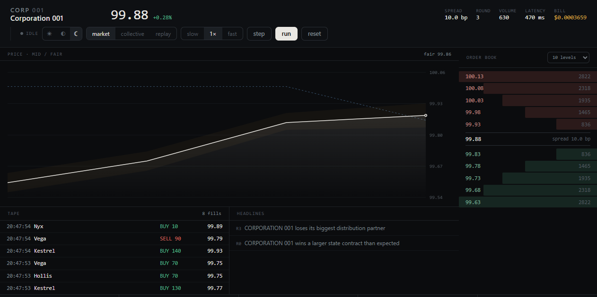
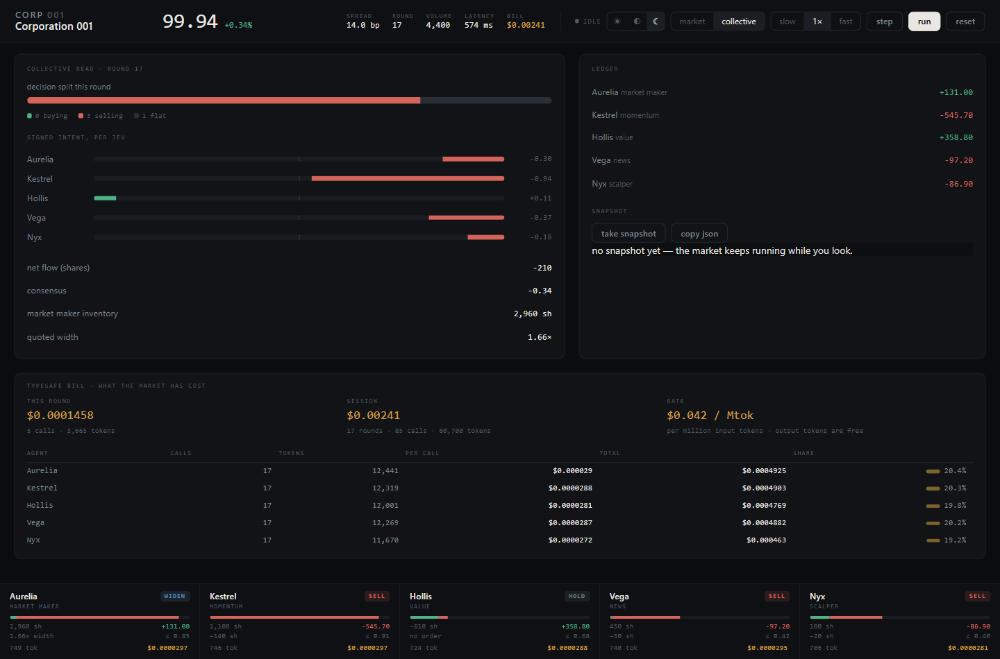
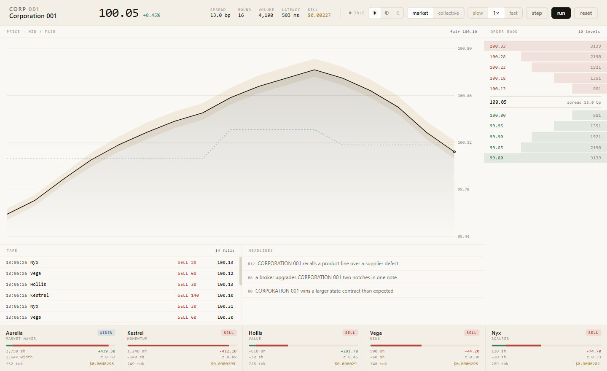
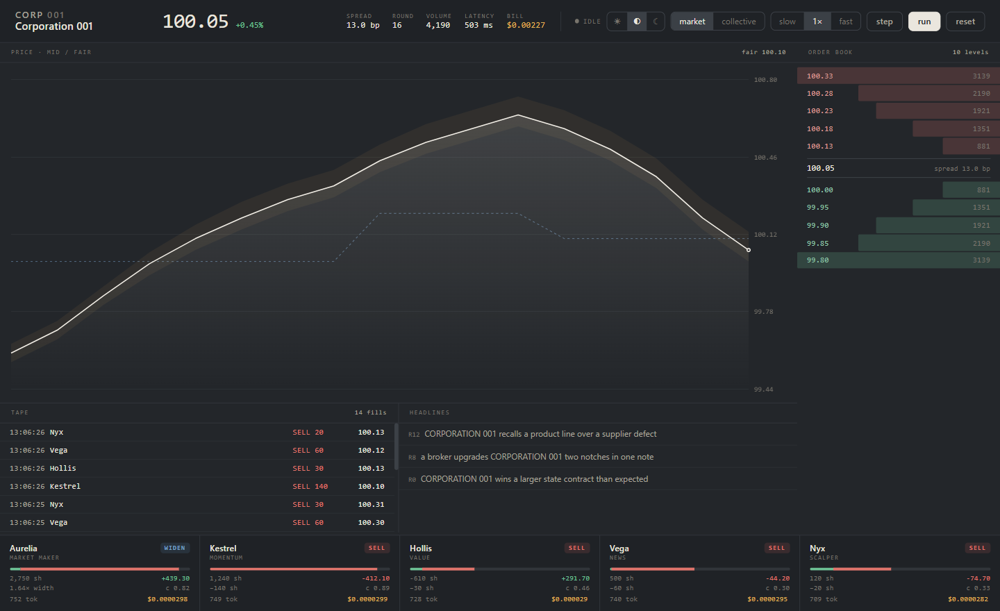
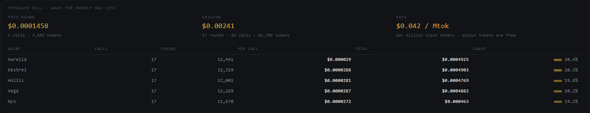
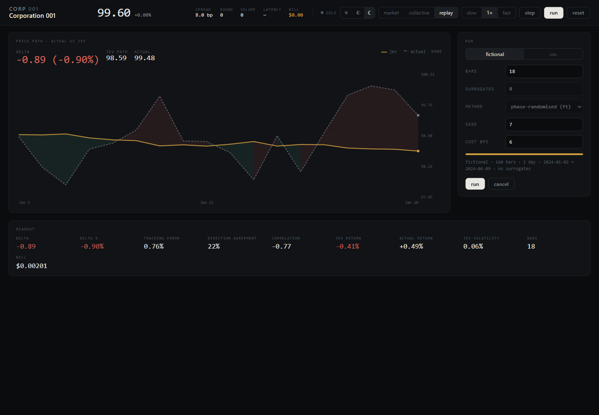
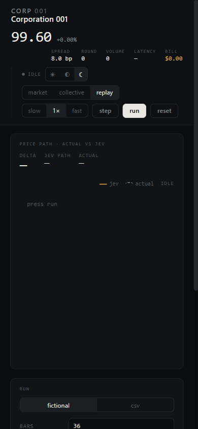

# Corporation 001

A microstructure market simulator where **every market participant is a Jev** — a TypeSafe System One
model answering one atomic probability question per round. Code, never the model, turns those
probabilities into orders, fills, price impact and quotes.

Five agents. One asset. One order book. ~350 ms per round, ~$0.00014 of API credits.



> ### ⚠️ Not built yet: strategy slots (coming soon)
>
> **[Strategy slots](strategy-design.html)** — swappable per-agent strategies, so a Jev question can be
> replaced by a rule from a paper or by a real market-making model for Aurelia — are a **designed but
> unshipped future feature**. Nothing in this repo implements them: there is no `strategies.mjs`, no
> slot registry, and no UI for it. The five agent behaviours you can run today are exactly the ones
> hard-coded in `market.mjs` / `replay.mjs`.
>
> The design page is a proposal for review, not documentation of current behaviour. Treat every
> mention of "slots" as *planned*, and read the rest of this README as what the code does now.

## Why it exists

Most agent simulations hide the judgement inside a prompt that returns a string you then parse. Here
the judgement is a typed, calibrated distribution over three mutually exclusive actions — and the
distribution stays visible. You can watch `p(buy) − p(sell)` become a 60-share order, watch the book
move, and watch the same five models change their minds as the tape changes.



## Quick start

```bash
git clone https://github.com/him300/corporation-001.git
cd corporation-001
cp .env.example .env          # then put your TypeSafe key in it
npm start                     # → http://127.0.0.1:4362
```

Optional, for real surrogates:

```bash
julia --project=julia -e 'using Pkg; Pkg.add("TimeseriesSurrogates")'
```

No dependencies to install. Node 20+ only.

Alternatively, skip `.env` and export the key:

```bash
TYPESAFE_API_KEY=sk_... npm start        # macOS / Linux
$env:TYPESAFE_API_KEY="sk_..."; npm start  # Windows PowerShell
```

Press **run**. Each round: five Jev calls in parallel, then the market reprices.

## The participants

| Agent | Role | Answers one question |
|---|---|---|
| **Aurelia** | market maker | tighten / hold / widen the quote |
| **Kestrel** | momentum | buy / sell / hold |
| **Hollis** | value | buy / sell / hold, against a fair-value gap |
| **Vega** | news | buy / sell / hold, on the latest headline |
| **Nyx** | scalper | buy / sell / hold, on the spread |

Aurelia is the counterparty to every fill, so her inventory is the negative of everyone else's and
carries real mark-to-market risk.

## How a decision becomes an order

```js
intent = p(buy) - p(sell)
size   = clamp(round(min(1, |intent| * 1.25) * maxSize / 10) * 10, 10, maxSize)
```

`p(buy)=0.62, p(sell)=0.30` → intent `0.32` → Kestrel buys 60 shares. Near-unanimity → the full 140.
Below `|intent| = 0.12` the agent holds; without that dead zone the book drowns in 10-share noise.

The maker's distribution becomes a width multiplier instead: `0.68 / 1.00 / 1.75`, blended by
probability and clamped to `0.6–2.2×` of a fixed 8 bp base spread.

## The two views

**Market** — mid/fair chart, an order-book ladder you can deepen from **10 rows to 100** (header of
the book panel), tape, headlines, and a live strip of every agent: its decision, probability bar,
`position … shares`, `P&L`, the order it placed, `confidence`, and what the call cost.

**Collective** — decision split, signed intent per Jev, consensus, maker inventory, ledger, the
TypeSafe bill, and a snapshot button that freezes the round to JSON.

Toggle with the header switch. `Space` run/pause · `S` step · `R` reset.

**How it decides** — `how-it-works.html` is a one-page diagram of both loops, the live round and the
replay, with the constants written on the arrows. The market server already serves it, so there is no
second port and no second process:

```
http://127.0.0.1:4362/how-it-works.html        (or http://<lan-ip>:4362/how-it-works.html on a phone)
```

If you have moved `PORT`, use that port instead — the path never changes.

## Three themes




Light / medium / dark, switched from the header and remembered between visits. Every colour is a CSS
custom property, so nothing is duplicated per theme — including the canvas chart, which re-reads the
active tokens on each draw.

## The bill

Every round is billed, and every bill is shown: **per call** on each agent card, **per round** and
**per session** in the header, and a full per-agent table in the collective view.



TypeSafe charges per **input** token — $42 per billion = **$0.042 per million**; output tokens are
free. The figure comes from the `usage` block on each response, not from a token estimate:

```
cost = input_tokens × 0.042 / 1e6        ≈ $0.00003 per call, $0.00014 per round
```

Override the rate with `JEV_PRICE_PER_MTOK` if it changes.

## Replay — trade a real price path



The market view is synthetic. **Replay** runs the same five agents over data you bring, one bar at a
time, with no look-ahead: at step *i* an agent sees `bars[0..i]` and nothing else. Their NAV, rebased
to the first close, is drawn against the actual close, and the gap between the two is the number:

```
delta = jev path - actual path        (price and %)
```

Feeding it:

| Source | Surrogates |
|---|---|
| **fictional** (default, one click) | none — a made-up series is already the null |
| **csv** | 0–8 |

```csv
DateTime,open,high,low,close,volume
2024-01-02,100.00,100.54,99.95,100.19,496596
```

Only `close` is required; `volume` changes how Vega reads events. Timestamps may be ISO, compact
`20230101`, dotted, or epoch — the interval is inferred either way. The **bar interval is detected from
the timestamps** — median gap, so weekends don't turn daily data into "1.4 days" — and shows up in the
run header and as ticks under the chart. `sample.csv` is 180 bars of fictional daily data.

## Surrogates — is it the data, or the agents?

Surrogates are generated by **[TimeseriesSurrogates.jl](https://github.com/JuliaDynamics/TimeseriesSurrogates.jl)**
— AAFT by default, with IAAFT, random fourier, block bootstrap and shuffle available. They keep the
volatility, autocorrelation and drift of your series and destroy its shape. Run *N* of them and each
one is drawn on the chart (numbered, faint) and listed in the table — one surrogate, one path, the
same series the agents traded:

| series | return | vol | skew | acf(1) | max dd | path ρ | delta |
|---|---|---|---|---|---|---|---|
| original | −0.69% | 0.84% | 0.22 | 0.294 | −4.2% | 1.000 | +0.43% |
| surrogate 1 | 3.23% | 0.92% | −0.52 | 0.092 | −2.5% | 0.241 | −3.79% |
| surrogate 2 | −0.09% | 0.64% | 0.06 | 0.282 | −2.4% | 0.469 | −0.32% |

Each surrogate is drawn in its own hue with its delta band against the actual close; click its row to
bring it forward. Wheel to zoom, drag to pan, double-click to reset — the framing follows the data
until you touch it. `path ρ` near zero is the point: same statistics, unrelated path. If the original's delta lands inside
the surrogate spread, what you are watching is the agents, not the data.

## From a phone, and from Telegram

```bash
HOST=0.0.0.0 ACCESS_TOKEN=$(openssl rand -hex 16) npm start
```

Startup prints the LAN address. Open `http://<lan-ip>:4362/?token=<token>` on the phone — the layout
collapses to a single column with a compact header.



`corp001.mjs` is a Telegram surface for the same server, installed as a Generative App:

```
corp001::fictional        run the fictional series, no surrogates
corp001::csv({"path":...}) run a CSV
corp001::surrogates       run surrogates for the last CSV
corp001::status           server + last run
```

It is a client, not a second implementation: state stays in the server, the app only remembers the
last summary.

## Configuration

| Variable | Default | Meaning |
|---|---|---|
| `TYPESAFE_API_KEY` | — | **Required.** Also readable from `.env` |
| `TYPESAFE_KEY_FILE` | — | Path to a file holding the key (Docker secrets, vault mounts) |
| `JEV_MODEL` | `jev-1.14.0` | Any System One model id |
| `PORT` | `4362` | HTTP port |
| `HOST` | `127.0.0.1` | Bind address. `0.0.0.0` for containers and public hosts |
| `ACCESS_TOKEN` | — | Shared secret that gates `/api/*`. **Set this before exposing the host** |
| `CORP001_URL` | `http://127.0.0.1:4362` | Where the Telegram app finds the server |
| `JEV_PRICE_PER_MTOK` | `0.042` | $ per million input tokens, for the on-screen bill |

## Hosting it

```bash
docker build -t corporation-001 .
docker run -p 4362:4362 -e TYPESAFE_API_KEY=... -e ACCESS_TOKEN=... corporation-001
```

Then open `http://<host>:4362/?token=<ACCESS_TOKEN>`. The page remembers the token for the session.

Without `ACCESS_TOKEN` the control API is open — anyone who finds it can start rounds and spend your
credits. On localhost that is fine; on a public host it is not.

## API

| Route | |
|---|---|
| `GET /api/state` | one-shot snapshot |
| `GET /api/stream` | SSE: `round`, `thinking`, `control`, `error` |
| `POST /api/control` | `{ "cmd": "start" \| "pause" \| "step" \| "reset" \| "speed" }` |
| `POST /api/replay/run` | `{ source, csv?, bars, surrogates, method, seed, costBps }` → `{ id }` |
| `GET /api/replay/stream?id=` | SSE for that run: one event per bar |
| `GET /api/replay/last` | the most recent finished run |

```bash
curl -X POST localhost:4362/api/control -H 'content-type: application/json' -d '{"cmd":"step"}'
curl -s localhost:4362/api/state | jq '.round, .mid'
```

## Roadmap

| Status | Feature | Notes |
|---|---|---|
| **Planned — coming soon** | **[Strategy slots](strategy-design.html)** | Swappable strategy per participant: today's Jev question, a rule from a paper, or a proper market-making model for Aurelia. Designed on paper only — see the caveat at the top of this README. |
| Shipped | Live round, replay, surrogates, Telegram surface, three themes | — |

Strategy slots are **not** part of the current release and no code path depends on them. The design
page states the intended contract and what it would touch (`strategies.mjs` new; `market.mjs`,
`replay.mjs`, `server.mjs`, `index.html` touched); it is a proposal for review, not a description of
this codebase.

## Limits, stated plainly

The Jevs are careful readers role-playing a role, not traders trained on order flow. Price impact is
linear and symmetric. Fair value is exogenous — no agent discovers it. There is one maker and no
competition. Positions are marked, never closed. **Consensus is a description of what five models
think right now, not a forecast.**

**[§26 Mechanics reference](MANUAL.md#26-mechanics-reference)** is the whole machine on one page:
every constant, the exact round as pseudocode, the book formula, the maker's multiplier and skew, the
state each agent receives, and what is deliberately absent.

The full reasoning, every formula, and the tuning table with its failure ranges are in
**[MANUAL.md](MANUAL.md)** (35 pages), or the rendered
**[PDF](CORPORATION-001-manual.pdf)**.

## Files

```
server.mjs    HTTP + SSE + the live loop + replay jobs
market.mjs    the live engine: book, agents, one round
replay.mjs    the replay engine: one bar at a time, no look-ahead
ohlcv.mjs     CSV parsing, descriptors, fallback surrogates
surrogates.jl surrogate generation (TimeseriesSurrogates.jl)
julia-surrogates.mjs  spawns Julia, one call per run
personas.mjs  the five-agent roster, shared
jev.mjs       TypeSafe client: key resolution, one fetch
index.html    the whole UI — markup, CSS, canvas, SSE client
replay.js     the replay view's browser code
how-it-works.html  the one-page diagram of both loops (served at /how-it-works.html)
strategy-design.html  future-feature design page for strategy slots (nothing implemented)
corp001.mjs   the Telegram surface
sample.csv    180 bars of fictional daily OHLCV
md2html.mjs   MANUAL.md → MANUAL.html for printing
```

## License

MIT — see [LICENSE](LICENSE). Replace the copyright line before publishing.
